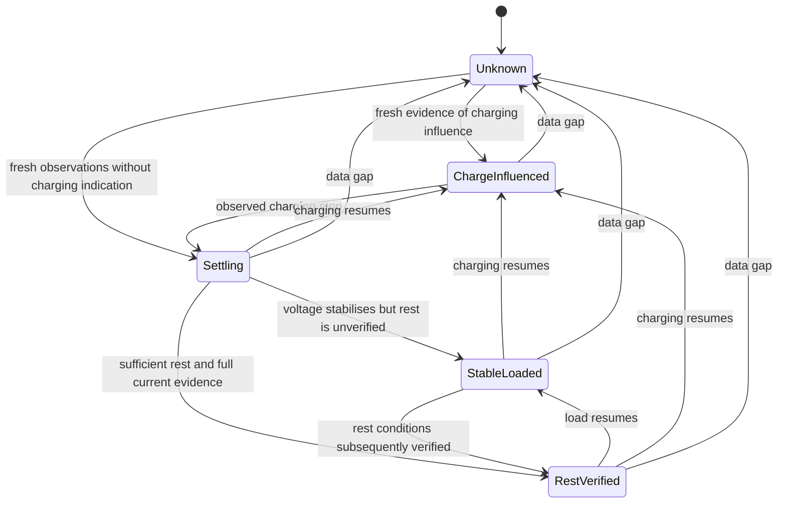

# Battery insights, timekeeping and notifications — concept

Status: original project-internal proposal, 2026-09-26. The user subsequently authorized implementation. Firmware 1.2.0 implements bounded Orion-channel observations, configurable local notifications and a validated network event clock; optional NMEA alerts remain experimental pending receiver tests. The current behavior is documented in [Diagnostics and notifications](../diagnostics-logging.md). The design discussion below records the original feasibility analysis, including estimators that remain unavailable. Hardware is unchanged.

## Decision

Proceed first with trustworthy voltage notifications, a network-synchronised event clock and observations of the two Orion channels. Keep battery SOC, resistance, runtime and health estimates unavailable until their measurement prerequisites are met. Do not publish a remaining-service-life number from the present data.

The user's requested 12 V warning is a configurable starting point for a confirmed 12 V battery installation. Each bank needs its own settings and source mapping. All values below labelled “proposed” are design choices to validate, not battery-manufacturer limits.

## What the current bridge actually observes

Source inspection: [Orion record](../../lib/OrionBridge/src/OrionFrame.h), [receiver](../../src/OrionBleReceiver.cpp), [main loop](../../src/dongle_main.cpp), [NMEA publisher](../../src/NmeaPublisher.cpp), [settings](../../src/BridgeSettings.h), [flash layout](../../partitions_4mb_ota.csv).

| Input | Current availability | Meaning and limit |
| --- | --- | --- |
| Input/output voltage | Yes, 0.01 V source steps | Orion channel voltage; wiring drop can separate it from battery-terminal voltage |
| Input/output current | Yes, 0.1 A source steps | Current through that charger channel; other loads and charging sources are not included |
| Charger state, error, off reason | Yes | Charger observations; not an independent ignition sensor |
| Packet counter, arrival time, RSSI | Yes | Receive quality and sample timing, not battery condition |
| Battery net current, terminal temperature | No dedicated source in the current bridge | Must not be synthesised from charger current or charger electronics temperature |
| Engine/ignition state | No application receiver or input handling | An available engine-network source must be identified and validated |
| UTC calendar time | No application handler yet | Can be added using a verified NMEA source |
| Continuous time while unpowered | No implemented facility | Saving the last timestamp cannot count an unknown power-off interval |

Normal charge-direction bookkeeping explains the current limitation:

- Starter battery net charging current = alternator current − other starter-side loads − Orion input current.
- Auxiliary battery net charging current = Orion output current + other charging current − auxiliary loads.

The bridge observes only the Orion terms. In particular, Orion output current can be zero while the auxiliary battery is powering a large load. Subtracting the two Orion currents does not yield either battery's net current. Complete battery-current measurement is also the basis of Victron's SOC calculation; its installation instructions require every relevant current path to be included. [Victron measurement arrangement](https://www.victronenergy.com/media/pg/SmartShunt/en/installation.html).

No additional current sensor, ignition wire or battery-backed clock is assumed installed. Battery roles, chemistry, capacity and power availability after ignition-off remain to be confirmed by the user.

Validate the voltage-sensing path for normal operation and for an open isolator, fuse or BMS switch. A powered charger can report fresh terminal voltage even when that terminal no longer represents the intended battery. Until this relationship is established, label the rule “Orion input/output low voltage”; a battery alias is a user label, not proof of electrical connection.

## Proposed calculated values

| Value presented to the user | Feasibility with current observations | Admission rule |
| --- | --- | --- |
| Channel power in W | Already available | Valid voltage and current from the same accepted record |
| Observed minimum/maximum voltage and voltage trend | Suitable for the first extension | Fresh samples and stated observation period; not a captured cranking minimum |
| Time below a voltage threshold | Suitable for the first extension | Known sample coverage, monotonic timing and configured threshold |
| Observed Orion transfer in Ah and Wh | Suitable for the first extension | Integrate only covered intervals; label it charger transfer, never battery capacity or remaining charge |
| Charger-active duration and time since observed charge stop | Conditional | Source state and coverage shown; not automatically engine running time |
| Battery SOC in percent | Not dependable from Orion-only observations | Complete net current with a synchronisation reference, or a separately validated rested-voltage method |
| Remaining operating time | Not dependable from Orion-only observations | Valid SOC/usable capacity and representative total discharge current |
| Apparent DC resistance in mΩ | Not dependable from routine Orion-only observations | Validated battery current change, voltage location, timing and operating conditions |
| Battery condition trend | Later, conditional | Comparable repeat observations and explicit quality gates |
| Remaining service life in months/years | Out of scope | No calibrated ageing model or sufficient battery history |

Every calculated value carries source, bank, units, observation period, age, coverage and a quality reason: measured, derived, estimate, insufficient data or stale. Unknown is not displayed as zero. Do not attach a numerical confidence percentage without a calibrated statistical model.

Use trapezoidal integration between distinct accepted samples for transfer totals:

`delta_Ah = 0.5 * (I_previous + I_current) * delta_t_seconds / 3600`

`delta_Wh = 0.5 * (P_previous + P_current) * delta_t_seconds / 3600`

Duplicate advertisements and repeated one-second NMEA transmissions are not new samples. A gap beyond the validated sample-gap limit breaks the integration segment; do not extend the last current across Bluetooth loss, restart or power-off. Report covered observation time alongside accumulated transfer. Handle verified reverse flow separately; do not take an absolute value and call it charging.

## Charging, shutdown and stabilisation

The user's concern is valid: the drop from regulated charging voltage after charging ends is not automatically a fault or evidence of a damaged battery. For the proposed passive resistance and voltage-based SOC estimators, charging and the following relaxation phase are excluded.

Use independent observations for `engine_running`, `charger_active`, `other_charge_present` and `battery_current`. Engine running does not prove alternator output; zero Orion current does not prove engine-off or battery rest. Victron describes its engine detection as voltage-based and configurable. [Orion operating manual](https://www.victronenergy.com/media/pg/Orion_XS_1400_DC-DC_Battery_Charger/en/operation,-configuration-and-monitoring.html).

Proposed assessment states:

A boot begins in Unknown. Fresh observations without a charging indication may start a new qualification window, even if no charging transition was observed; they do not establish how long the battery was previously resting. Do not restore a completed rest qualification across an unobserved power-off interval. A confirmed transition from an engine source can provide context; loss of engine messages is Unknown, not engine-off. Fresh RPM from an identified engine gateway can establish running; zero RPM does not establish ignition-off. The chartplotter's support for engine PGNs does not create an engine measurement source where none is installed.

Stabilisation uses a rolling voltage slope, spread and uninterrupted coverage together with the operating state. Its minimum observation window and slope limits must be fitted to recorded traces. A flat voltage trace under a steady load is StableLoaded, not RestVerified. Elapsed time alone must not promote either state to valid open-circuit voltage.

For a genuine rested-voltage estimate, require negligible **total battery current**, no charging influence, the battery-specific rest period and a suitable temperature/reference curve. As an illustration of the timescale, Trojan specifies at least six idle hours and preferably 24 hours for its open-circuit test. That is not a universal table for the user's battery and must not become a fixed five-minute rule. [Trojan battery maintenance](https://www.trojanbattery.com/resources/battery-maintenance).

**Voltage notifications run independently of these assessment states.** Normal post-charge relaxation blocks interpretation as battery degradation; it does not suppress a persistent measured voltage below the configured limit. A short starter or thruster event may cross 12 V without indicating ageing. Confirmation time, context and optional tightly bounded cranking treatment prevent nuisance alerts without hiding sustained undervoltage.

## SOC and remaining runtime

With complete, correctly mapped net current, SOC can later be estimated by charge integration with a known starting reference, usable capacity, charging efficiency and chemistry-specific corrections. A charger entering Float alone must not set the battery SOC to 100% while other loads or charge paths are unknown. Victron's monitor documentation explains current integration, synchronisation and discharge-rate effects; these requirements cannot be replaced by the Orion's charger-current reading. [Victron monitor operation](https://www.victronenergy.com/media/pg/SmartShunt/en/operation.html).

A rested-voltage method would be a separate, explicitly approximate estimate using the actual battery manufacturer's curve. Do not automatically use a lead-acid curve for AGM, GEL or LiFePO4. Do not extrapolate voltage linearly to an “empty in X hours” figure during changing load or post-charge relaxation.

Runtime becomes meaningful only with usable charge above a selected reserve and a representative **total** discharge load. It is a conditional forecast at that load, not a promise. Missing samples, changed loads or uncertain capacity reduce its quality; insufficient evidence makes it unavailable. Remaining runtime and remaining battery service life are separate concepts.

## Apparent resistance and battery ageing

`Voltage / current` gives an operating-point ratio, not battery internal resistance. For a discharge-current increase, a conditional DC estimate is:

`R_apparent = (V_before − V_after) / (I_discharge_after − I_discharge_before)`

Keithley's pulse-measurement example uses before/after voltage and current and four-wire sensing to remove lead effects. It also describes charging pulses; excluding charging here is a limitation of the proposed passive estimator, not a general physical prohibition on resistance measurement. Its cell example does not establish test settings for this boat battery. [Keithley DC resistance measurement](https://www.tek.com/de/documents/application-note/measuring-battery-dc-internal-resistance-with-a-24xx-graphical-smu-and-tsp-technology).

Example for explanation only: a 0.10 V drop for a 20 A increase corresponds to 0.005 Ω, or 5 mΩ. The available 0.01 V voltage steps alone correspond to 0.5 mΩ at that current change; this does not include sensor accuracy, timing, temperature or wiring uncertainty.

Admission requires all of the following:

1. No charging influence and completion of the relevant relaxation qualification.
2. The actual battery-current change is known; simultaneous unobserved loads invalidate the result.
3. Voltage and current samples bracket the same event at a defined response interval, with enough fresh samples and signal change above noise/quantisation.
4. Battery temperature and charge state are comparable to the reference, or the result is explicitly unqualified.
5. The measurement location is known. Orion-terminal voltage includes cable/contact effects; call that a path-resistance estimate, not isolated battery resistance.

Routine BLE updates do not establish the bandwidth needed to capture a starter-current step. A steady Orion-off period often provides no usable current stimulus at all. The passive first release therefore shows resistance as unavailable. Do not automatically switch the charger or boat loads to create a test.

A later controlled measurement could track comparable resistance or usable-capacity changes and suggest “Battery check recommended”. Resistance is not itself capacity or a calibrated SOH percentage. Do not convert an arbitrary resistance increase into “80% health” or “two years remaining”. Calendar-life forecasting would additionally need battery-specific ageing data, temperature exposure, charging history, cycle depth and a validated failure criterion.

This is a project feasibility conclusion, not a manufacturer life model. EnerSys discusses temperature, charge state, connections and electrochemical effects on ohmic measurements, and their imperfect relation to capacity, for its VRLA products. Its discussion supports comparing qualified observations with a baseline; its product-specific limits must not be transplanted to an unidentified battery. [EnerSys application manual, battery life and ohmic testing](https://www.enersys.com/493c0d/globalassets/documents/product-documentation/datasafe/npx/emea/us-np-am-003-0111.pdf).

## Time from Garmin and time during outages

Garmin's GPSMAP 7x3/9x3/12x3/16x3 table lists **129029 GNSS position data as transmit/receive**, but **126992 System time as receive**. Therefore the primary candidate from the GPSMAP 723xsv is the date/time in 129029; do not assume that this chartplotter sends 126992. Accept 126992 only from another verified time source. The same table lists battery/charger data and alert PGNs, which establishes protocol support but not acceptance of this device's chosen alert identity. [Garmin PGN table](https://www8.garmin.com/manuals/webhelp/GUID-BF2FF273-008A-482A-A96F-362ADA8996BA/EN-US/GUID-0C4B3FAB-3E41-438C-B31E-9B5489790913.html).

Proposed clock design:

- Start a 64-bit monotonic clock immediately. All integration, freshness, debounce and rest windows use elapsed monotonic time, even before UTC is known.
- Receive date/time asynchronously whenever it becomes available; never block startup waiting for Garmin or a GPS fix. The current NMEA parser already processes the bus but has no application time handler.
- Preserve the current node mode: `NodeOnly` does not disable reception. Add receive declarations and handlers for the selected messages. The main loop currently starts NMEA only after Orion provisioning; decide explicitly whether clock reception is required before provisioning and retain the existing safe behaviour for devices without a CAN interface.
- Validate available date/time, GNSS/time status, source identity and repeated consistent observations before accepting an anchor. Select by device NAME and policy, not a permanently assumed CAN source address.
- Keep a pair of UTC and monotonic timestamps plus source, last-sync age and time quality. During continuous power, UTC can continue in holdover while the source is absent, with increasing uncertainty.
- Validate periodically and after source return. A backwards jump or conflicting clock starts a new mapping segment or remains quarantined; it never produces negative integration time or changes alarm delays.
- Before the first valid anchor, events have boot ID and uptime. Within the same boot, an accepted anchor can give them explicitly estimated UTC timestamps. Do not rewrite history silently.
- After a full power loss, the stored last UTC is historical. It cannot reveal how long the bridge was off. New network time can bracket the missing interval later; no current integration or self-discharge estimate fills it automatically.
- If calendar time must survive independent of the network, specify a separately powered time source as a future requirement. No such hardware is assumed now. Store UTC; time zones are a presentation choice.

If ignition-off or switching off the Garmin also removes NMEA backbone power from the bridge, it cannot observe the subsequent voltage relaxation or warn during that interval. Power wiring and continued Orion advertising are first-phase measurements, not software assumptions.

## Notifications menu

Add **Settings → Notifications** / **Einstellungen → Benachrichtigungen** in the proposed UI. Enable/disable notifications globally, per battery and per rule. Keep rule evaluation, event history, acknowledgement and delivery status distinct.

Proposed settings:

| Setting | Proposal |
| --- | --- |
| Notifications enabled | Explicit master boolean; disabled state remains visible |
| Bank | Input/output mapping, user label, nominal voltage, battery type and capacity where known |
| Low voltage enabled | Per-bank boolean |
| Warning threshold | 12.00 V, as requested, for a confirmed applicable 12 V bank |
| Confirmation duration | Initial proposal: 10 seconds of covered low readings and at least three distinct accepted samples |
| Clear threshold | Initial proposal: at least 12.30 V for 30 seconds of covered readings |
| Delivery | Portal and optional NMEA alert delivery, each with a separate toggle |
| Repetition | User reminder once per activation; optional reminder period; remote alert-state reconciliation is separate |
| Acknowledge | Silences/acknowledges that event without claiming the voltage has recovered |
| Further rules | High voltage, data unavailable, charger error; low SOC only when a valid SOC source exists |

The 12.30 V clear point and both durations are provisional anti-chatter settings, not validated battery protection limits. A 12 V threshold must not be applied automatically to an unknown nominal voltage or chemistry. Input and output thresholds can differ. A battery profile change invalidates incompatible estimates and requests review of the selected limits.

Rule behaviour:

1. Fresh source data enter Normal or Pending. Trigger when valid observations remain below threshold for the confirmation window. Validate actual advertisement cadence before fixing the allowed sample gap.
2. Any invalid or excessive-gap interval resets Pending. Repeating an old sample cannot complete the timer.
3. Once Active, a data gap changes assessment to Unknown with the previous alert retained, plus a separate data-unavailable indication. It does not report recovery.
4. Clear only after fresh observations satisfy the clear threshold and clear duration. Acknowledgement and recovery are different events.
5. Charging and relaxation do not disable this voltage rule. Optional cranking grace needs a validated trigger, a strict maximum duration and its own visible configuration; initial scope has no inferred blanket ignition mask.
6. Disabling a rule records a settings event and shows “Monitoring disabled”. Withdraw/cancel a previously published remote alert using the validated protocol lifecycle; retain reconciliation work if the network is absent. It must not relabel the bank healthy. A bank remap withdraws the old identity before using the new one. Restart re-evaluates current data and reconciles current remote alert state instead of restoring a blind healthy state or replaying every historical alarm.

Use the existing administrator authentication, CSRF handling and atomic settings patterns. Keep notification settings separate from credentials and connection assignments; failed storage must leave the previous configuration intact. Render user labels safely and validate threshold order, finite numbers, ranges and timer bounds on both client and server.

## Getting the warning to the captain

The alert engine runs in the bridge, independently of whether the portal is open. A web banner is visible only while a browser is connected; the current service Wi-Fi can close after five minutes without a client. Browser audio or background push cannot be assumed. No local buzzer is assumed installed.

The intended helm path is a NMEA alert from the bridge to Garmin, with text, active/clear lifecycle and acknowledgement. Prototype the supported alert and response PGNs against the actual plotter firmware, including the device's source identity and battery mapping. A successful CAN submission is not proof of visible or audible notification. A generic battery data field also does not automatically create a chartplotter alarm.

Candidate message set: 126983 Alert and 126985 Alert text, with 126987/126988 threshold/value where required, and 126984 Alert response on the return path. Current library inspection found no ready application codecs for these alerts; add and verify proper codecs and identifier semantics against the authoritative message definitions as part of the prototype. The plotter's separate “Unit Voltage” alarm must not be assumed to cover both remote battery instances. [Garmin system alarms](https://www8.garmin.com/manuals/webhelp/GUID-3E67C80C-0812-4EEC-BC60-699751B9CF6F/EN-US/GUID-353F7FD4-424B-4993-8124-A3CB450297BE.html).

Expose active rule, measured voltage and location, threshold, duration, quality and delivery state in the portal. Show last notification and unacknowledged history when reconnecting. If the chartplotter/network is off or disconnected, record the condition locally where power/storage permit, but do not claim the captain was notified.

“Once per activation” limits user reminders, not the protocol's required retransmission or reconciliation. When the network or receiver returns, announce still-active alerts and withdraw cancelled ones under the verified lifecycle, without creating a new incident for every retry. Track outstanding state separately from observed receiver response; account for receiver discovery and any required periodic announcement. Do not claim remote clearing while the receiver is unreachable.

Keep calculated diagnostics in the portal first. Publish SOC/SOH/runtime in standard battery fields only if valid, correctly mapped and supported by the receiver. There is no verified Garmin display mapping here for arbitrary resistance, confidence or life-forecast sensors; never repurpose an unrelated temperature or alarm field to carry them.

## Architecture and storage boundaries

Proposed modules: `BatteryObservations` (sources/coverage), `TimeBase` (monotonic and UTC anchors), `BatteryAssessment` (state/quality), `NotificationRules` (per-bank lifecycle) and `NotificationDelivery` (portal/NMEA). Calculation inputs are immutable snapshots with explicit validity; UI settings and NMEA callbacks must not race on partially updated state.

The current 4 MB flash layout reserves only 0x5000 bytes for NVS, which already contains credentials, certificates and settings. It provides no dedicated history filesystem. Begin with bounded RAM windows, bounded event history and only small, infrequent, atomic summaries after measuring storage headroom and write endurance. Preserve the OTA layout and authentication space. A durable long-term trend store needs its own capacity/migration plan; saving every sample to NVS is not acceptable.

Persist source identity, schema version and battery-profile identity with summaries. A replaced battery or changed chemistry invalidates its learned baseline. Export a bounded CSV history through the authenticated portal as a possible inspection aid; observation gaps and time quality must be included.

## Delivery stages and acceptance

| Stage | Scope | Exit evidence |
| --- | --- | --- |
| 0 — Observe | Record real voltages/currents and charger state before/after engine-off; verify bank mapping, sensing path through isolation states, power, BLE cadence and network sources | Time-aligned trace compared with battery-terminal measurements and VictronConnect; no new estimates enabled |
| 1 — Notify | Configurable voltage/data-loss rules, clock, portal status and a Garmin alert prototype | Boundary/gap/restart tests plus visible/audible activation, acknowledgement and clearing on the installed Garmin |
| 2 — Describe | Covered channel Ah/Wh, voltage trends, duration counters and clearly qualified operating states | Reference trace replay; duplicate/gap handling; timestamp jumps leave integration/timers unchanged |
| 3 — Estimate, conditional | SOC/runtime/resistance only with the missing measurement inputs and battery-specific validation | Comparison with independent battery measurements; error bounds and rejection conditions demonstrated |
| Later research | Battery health trend with a calibrated baseline | Comparable observations over time; no calendar-life claim without separate validation |

Required cases include: threshold chatter; exactly 12.00 V; persistent 11.90 V; normal post-charge voltage drop above the threshold; low voltage while charging; valid samples interrupted by gaps; duplicated packets; missing time at boot; later UTC sync; conflicting/backwards UTC; clock rollover avoidance; restart during an active warning; changing bank identity; disabled notifications; plotter off; NMEA send failure; acknowledgement while still low; and recovery followed by a new incident. Use synthetic traces and an isolated bench supply for threshold tests before testing on the installed system. Do not deliberately deep-discharge the boat battery or interrupt power to critical boat equipment for validation.

Also verify plotter return during an active incident, disable/remap after successful remote delivery, cancellation while offline followed by reconnect, and fresh charger data with a disconnected battery sensing path. These cases must not leave a false healthy state, miss an ongoing warning or strand a cancelled remote alert.

## Open installation inputs

- Which bank(s): starter, auxiliary/bow or both? Which nominal voltage, chemistry, capacity and manufacturer reference apply to each?
- Do Orion, bridge and NMEA backbone remain powered and observable after ignition-off and after Garmin is switched off?
- Which other loads/chargers bypass the Orion, and is a trustworthy total-current source already available on the network?
- Which exact charger firmware and operating modes are installed? Current decoding assumes the established advertisement format. Reverse-charge operation needs separate validation; it is not covered by the present signed/unsigned assumptions and current plausibility limits.
- Does the network provide a valid engine source and a chartplotter time source? Confirm their device identities and actual broadcast behaviour.
- Which helm warning presentation and audible behaviour does the installed Garmin accept for this device?

The proposed first implementation is voltage notifications plus reliable time/event handling. Missing battery-estimation prerequisites must not delay those useful functions, and their existence must not be implied in user documentation before they are implemented and tested.
