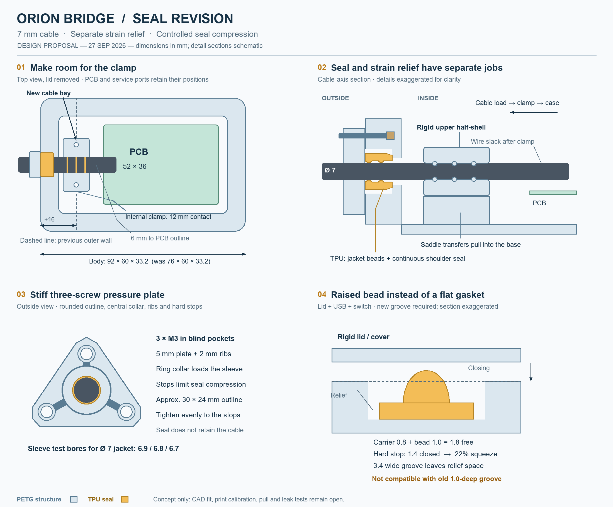

# Enclosure seal and strain-relief concept — 27 September 2026

Status: approved design proposal. Its implementation, current print files, validation and manuals are in [sealed-v2](../sealed-v2/README.md). This folder retains the original concept drawing and design rationale; use the V2 instructions for manufacturing. Previous CAD, STL, 3MF, user test plates and process presets are preserved. The user reports that the printed 95A TPU seals are too stiff; the cable is not retained and the pressure cap bends. SainSmart Flex TPU Air (advertised 77A–93A) has been ordered, not physically tested here.

The [vector drawing](seal-redesign.svg) is suitable for zooming. Drawn dimensions are proposed nominal values; section details are schematic and exaggerated. The user confirmed a **7 mm cable jacket diameter** during this review; the concept uses this value.

## Evidence from the existing design

Reviewed `../sealed-print/sealed-contract.json`, `../sealed-print/README.md` and `../../../../tools/build_orion_r5_sealed_enclosure.py` (relative to this directory).

- Body: 76 × 60 × 33.2 mm; PCB: 52 × 36 mm, underside at Z=8 mm.
- Cable centre: Y=18, Z=14 mm, entry on X−. Outside wall X=−12; inner wall X=−4; PCB starts at X=0. Only 4 mm separates the board outline from this wall.
- Existing pressure cap: 30 × 18 × 3.2 mm, two M3 screws 22 mm apart.
- Cable pocket: diameter 12.2 mm, depth 6 mm, through-hole 7.6 mm. Cartridge length 7 mm closes to 6 mm (14.3%). Its nominal bore is cable diameter minus 0.2 mm.
- The generator targets 1.005 times the available closed annular volume (100.5% fill). This can cause a sharp force increase as an almost incompressible seal becomes confined. It is a plausible contributor to the reported bending, not a measured force analysis. Actual cable diameter, print overextrusion, material and plate stiffness also matter.
- Existing lid/USB/switch seals are flat, 2.4 mm wide × 1.2 mm high, closed to 1.0 mm in 3.4 mm wide grooves. They already have rigid compression stops. Preserve this principle.

## Proposed geometry

### 1. Dedicated cable bay inside the enclosure

Extend the complete cable-side end by **16 mm**: body X range −28…64 instead of −12…64. New body target is **92 × 60 × 33.2 mm**, excluding ears, covers, ribs and screw heads. Keep the PCB, USB and service-switch positions. Extend the lid and its continuous seal; relocate the two cable-side lid screws with the end wall. This is a new base/lid revision, not a retrofit cap alone.

The new inner wall is X=−20. Reserve X=−18…−6 for a 12 mm long jacket clamp, leaving 2 mm to the wall and 6 mm to the PCB outline. This is a layout reservation, not a collision-checked assembly. Check screw-driver access, component bodies, solder joints, conductor bend radius and wiring before freezing CAD.

### 2. Independent internal strain relief

Use a PETG lower saddle integrated into the base and a removable PETG upper half-shell. Two vertical M3 screws, one on each side of the cable, engage **blind internal bosses**; neither enters the exterior bottom. Buttress the saddle/bosses into the floor and wall so cable load enters the enclosure, not the PCB.

Starting geometry: 12–14 mm jacket contact length, three broad rounded transverse ribs, 0.3–0.4 mm rib height, at least 0.6 mm crest radius. Avoid sharp teeth and severe alternating bends. Tailor both half-shells to the measured intact jacket. Leave an adjustable gap between the halves; determine a travel stop from jacket tests, not an assumed universal clamp interference. An optional 0.6–0.8 mm dense 95A TPU liner can cushion the saddle; the foam seal is not the load-bearing clamp. Keep conductor slack after the clamp and never clamp stripped wires.

The concept leaves room for the shell; actual cable retention, jacket indentation and creep remain to be measured. Do not specify tightening torque without an insert/jacket test.

### 3. Rounded triangular pressure plate

Three screw centres in the wall Y/Z plane: (18,24), (7,8), (29,8) mm. Cable centre stays (18,14). A rounded triangular outline around these centres is approximately **30 × 24 mm**; the rigid plate is **5 mm thick**, with **2 mm external ribs** connecting the screw regions to a central pressure collar. Keep flat washer seats at the 5 mm level, so ribs do not tilt screw heads. The annular pressure collar loads the sleeve uniformly; it must clear the cable.

Provide three coplanar hard-stop lands and blind insert pockets outside the circular wet path. Tighten in small alternating steps until all lands meet, not until the cable resists pulling. Three screws improve the load path only with a sufficiently stiff plate and uniform contact. The roughly 3.8-fold increase in plate bending stiffness from 3.2 to 5 mm (thickness cubed) is an ideal same-material/same-span comparison, not a stress or creep qualification.

M3 × 8 from the old cap may be too short through the thicker plate. Select length from actual plate/washer thickness, insert engagement and blind-pocket clearance; M3 × 10 is a candidate only with confirmed dimensions. Budget three additional M3 screw/insert sets versus the old design: one extra for the cap, two for the internal clamp. Verify the purchased insert bodies before defining pilots.

### 4. Cable sealing cartridge

Retain an **unsplit** sleeve threaded from the bare end before termination. Keep the 12.2 mm pocket and 6 mm closed length as an initial coupon interface. Test free lengths 6.6, 6.8 and 7.0 mm (9.1%, 11.8%, 14.3% axial compression). Start with 6.8 mm. These are alternatives, not stacked spacers.

Replace the bulk-filling cylinder with a relieved body, two rounded internal circumferential sealing beads against the jacket, and a continuous annular end-face bead against the pocket shoulder. The outer body has relief space so displaced TPU is not forced into a fully packed cavity. No slot or relief may cross either continuous seal path. The rear face bead must bridge the complete path around the through-hole; otherwise water can bypass the cable seal along the outside of the sleeve.

For the confirmed **7 mm jacket**, initial bead-bore alternatives are **6.9 / 6.8 / 6.7 mm** (0.1 / 0.2 / 0.3 mm diametral interference); start at 6.8 mm. Nominal body OD around 11 mm is a starting envelope, not a final gasket specification. The existing 7.6 mm rigid through-hole leaves only 0.3 mm radial clearance to this cable; verify printed bore and cable ovality, and revise if required. Final bead radii, shoulder width, bore fit and relief volume need a sectional coupon and CAD checks. Do not reuse the old 100.5% cavity-fill rule for foam. Do not rely on axial compression of foam alone to generate radial cable contact: the inner beads establish contact directly.

### 5. Lid, USB and service-switch gaskets

For the revised parts, use a continuous flat carrier with a rounded raised sealing bead. Initial section: 2.4 mm carrier width, 0.8 mm carrier height, approximately 1.2 mm bead width and 1.0 mm bead height; total free height **1.8 mm**, closed height **1.4 mm** (22.2% nominal total compression). The groove remains about 3.4 mm wide and becomes 1.4 mm deep, with room beside the bead. The continuous bead concentrates contact with less loaded area than the old flat section. Its force and recovery must still be tested.

This section requires deeper grooves; **do not install it in the old 1.0 mm grooves**. First test 1.4 and 1.6 mm closed-height coupons to compare compression force and recovery. Preserve rigid flange stops; add exterior ribs to USB/switch covers where they span between screws, while leaving the gasket contact face flat. Check remaining groove-floor thickness before deepening service-cover grooves; increase cover thickness if required. Keep the flush-colour outer lid artwork intact when extending the lid.

A low-cost first material comparison can use the existing 1.2 mm flat gasket files at the original 1.0 mm stop. That is a material trial, not the revised bead design.

## SainSmart TPU Air: first-print plan for the P2S

Manufacturer facts: SainSmart advertises temperature/speed-dependent 77A–93A, a 210–270 °C nozzle range, a 40–60 °C bed, moderate cooling and printing at no more than 50 mm/s. The page does not establish an exact temperature-to-hardness curve on this printer or water permeability/compression-set performance. Source: [SainSmart Lightweight TPU](https://www.sainsmart.com/products/lightweight-tpu-filament), consulted 27 September 2026. Do not transfer Siraya Tech TPU Air hardness/flow tables to this material.

All settings below are **proposed calibration starts**, not manufacturer-certified seal settings. Assume a 0.4 mm nozzle; adapt for the actual nozzle. Create separately named material/test presets, preserving the user's successful enclosure settings.

| Part | Initial temperature and comparison | Orientation / structure | Selection criterion |
| --- | --- | --- | --- |
| Lid gasket | Start 245 °C; compare 235 and 255 °C | Flat carrier down, continuous bead up; 0.20 mm layers | Lowest force that still gives continuous contact and recovery |
| USB gasket | Start 235 °C; compare 245 °C | Flat carrier down, bead up; 0.20 mm layers | Clean small features, no torn or porous-looking contact face |
| Switch gasket | Start 235 °C; compare 245 °C | Same as USB gasket | Avoid excessive expansion obscuring the small bead |
| Cable sleeve | Start 235 °C; compare 245 °C | Cable axis vertical, shoulder sealing bead upward; no supports on sealing faces | Accurate bead bore plus jacket and shoulder sealing |
| Optional clamp liner | Existing 95A, unfoamed, manufacturer temperature | Dense, flat; 0.20 mm layers | Durable jacket cushioning rather than soft compression |
| Pressure plate and clamp | PETG using the established enclosure material calibration | Plate flat with ribs up; clamp saddle axis horizontal where practical, contact faces support-free | Stiffness, insert retention and smooth jacket contact |

For all TPU Air trials: external spool with a low-drag feed path; dry using this spool's instructions and print from dry storage. Start at **50 °C bed**, **20 mm/s** for walls and solid infill, **15 mm/s first layer**, **30% part cooling** after initial adhesion, with auxiliary fan off. Use **3 walls**, **5 top/bottom layers**, **100% infill**, and 0.20 mm layers. Short retraction around 0.4 mm is only a direct-drive trial start; reduce if feed problems occur. Select the actual build plate in the slicer and use a compatible release layer where needed. A smooth plate gives a better starting sealing face than coarse texture; keep the functional bead on the upper surface. No ironing or support scars on contact faces.

100% infill means no intentionally sparse internal pattern. The material can still foam inside each extrusion. It does **not** guarantee a nonporous wall. Do not use 10–20% infill or deliberate underextrusion to make a seal softer. Nor does a thick perimeter automatically create an unfoamed skin at a foaming temperature.

Calibrate flow separately for **each temperature at the actual part speed**. Start with the supplier's exact material profile if provided; otherwise establish the low-foam baseline on a small coupon first. Reduce extrusion progressively as expansion increases until the printed wall thickness and overall dimensions agree with the model without gaps or swollen seams. No universal 50% flow or exact Shore number is assigned. If a measured line is too wide, ratio_old × target_width/measured_width is only an initial correction; verify with a multiwall/solid coupon and actual seal. Keep temperature, speed, fan, layer height and minimum-layer-time effects documented. Small service seals must be calibrated at their actual slowed speed, not only on a large test tower.

Print the 235/245/255 °C comparisons as separate jobs after temperature stabilisation. A three-temperature tower alone cannot isolate flow-dependent size changes. Target moderate foam first. Only investigate 260–270 °C / maximum softness if moderate samples cannot conform; reject a softer setting if its leakage or permanent set is worse. Shore hardness cannot be inferred reliably from temperature or finger feel; small gaskets are also unsuitable as standard durometer specimens.

Use 5–6 walls and solid local regions around screw seats, the annular pressure collar and clamp ribs for PETG. The new small pressure plate can be printed solid. Final orientation and screw lengths remain part of the revised CAD/slicer check.

## Acceptance sequence and open work

1. Measure jacket diameter in several positions/directions. Record the actual TPU Air product/colour, nozzle, drying, temperature, speed and calibrated flow.
2. Print material coupons and compare equal geometry. Check width, height, bead bore, extrusion continuity and pressing force. A simple scale/parallel-plate fixture can compare force, but is not a Shore measurement.
3. Print a representative entry-wall coupon with the new cap, sleeve and separate clamp. Verify inserts, three hard stops, plate deflection and all dry clearances before a full enclosure.
4. Assess clamp retention independently of seal friction, using a marked jacket and controlled service-representative load. With electronics removed, inspect movement, insert loosening, jacket indentation and wire slack. Establish the required force from the real installation; no certified pull-force threshold is claimed here.
5. Compress seal samples against their stops for 24–48 hours; inspect relaxation and leakage, then release and compare height recovery after a defined rest period. Repeat at representative temperature and after service cycles.
6. Test the assembled empty enclosure with absorbent paper under the intended splash exposure; dry the outside before opening. Inspect cable/jacket contact, sleeve shoulder, covers, lid and FDM walls. Repeat after cable flexing and pull testing. These are screening tests, not an IP certification.

Foam compliance is useful only if the material also seals. The manufacturer's page provides no evidence here of closed-cell watertightness or long-term compression set. [Prusa's published closure experiments](https://blog.prusa3d.com/watertight-3d-printing-part-2_53638/) illustrate that printed flexible seals can fail even with apparently solid geometry. If the TPU Air samples seep or take a permanent set, retain the separate clamp/stiff cap concept and size the seat for a selected conventional silicone/EPDM seal or suitable commercial cable gland.

- [x] User's physical 95A failure recorded; procurement of TPU Air recorded.
- [x] Existing dimensions and interference risks inspected; four-view concept and print plan prepared.
- [x] User confirmed 7 mm jacket diameter; sleeve test bores updated to 6.9 / 6.8 / 6.7 mm.
- [ ] Jacket ovality/tolerance and purchased insert dimensions confirmed.
- [ ] Revised CAD solids, printable coupons, clearance checks and updated 3MF produced.
- [ ] Material flow, sealing, creep, plate deflection and independent strain relief physically validated.
- [ ] Production assembly manual/hardware list updated after the new geometry is fixed.

No mechanical collision, finite-element, slicing or water test is claimed for this concept. The drawing is a reviewable proposal. Existing digital validation applies only to the older geometry and does not override the user's failed physical trial.
