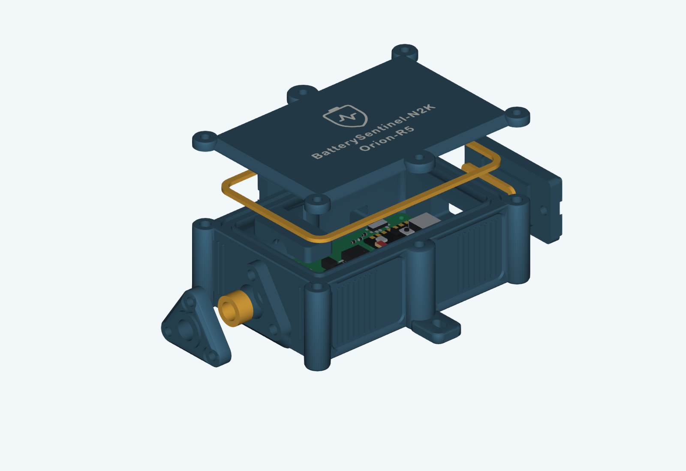
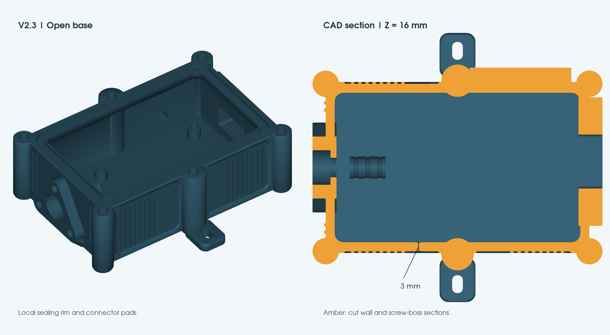

# Orion Bridge enclosure V2.3 - thin walls and projecting screw bosses

This revision implements the approved 27 September 2026 concept for the user's **7 mm cable jacket** and ordered **SainSmart Flex TPU Air (77A-93A)**. It separates cable retention from sealing. The previous 95A TPU trial failed to retain the cable and bent the pressure cap; softer material alone is not treated as a complete correction.

The main shell is nominally **88 x 57.2 x 33.2 mm**, with **3 mm free wall fields and floor**. The six round screw bosses project from the walls; their maximum envelope remains 96.8 x 68.8 x 33.2 mm. Mounting ears, covers and screw heads extend farther. The 52 x 36 mm PCB, separate cable clamp, service planes and centred flush lid artwork remain. The cable pressure cap has three screws, a 5 mm plate and a closed faceted shoulder. Face seals retain 1.8 mm free height and 1.4 mm closed height.

**Prototype, not physically qualified.** See the digital reports below. A valid CAD solid or successful slice is not evidence of waterproofness, Shore hardness, clamp retention or a tested IP rating. The old print files and user test plates remain intact in `../sealed-print`; do not mix old and V2 seals.

## Thin-wall correction

V2.2 filled the whole external boss envelope while retaining the old cavity, creating an unnecessarily continuous 11.4 mm long-side wall. V2.3 reduces the wall envelope and expands the lower cavity by 3 mm on each side. The six screws remain in their symmetric positions; each now has an individually projecting round boss. `preview-styled-presentation.png` renders the actual CAD with illustrative screws/cable. The V2.2 package is preserved in `output/Orion-Enclosure-V2.2-Print-Package.zip`.

| Area | Nominal CAD dimension / reason |
| --- | --- |
| Free wall fields / floor | 3.0 mm |
| Texture ribs and unrecessed long-side bands | 3.6 mm; 0.6 mm relief above the structural wall |
| Upper sealing rim | 6.0 mm at ends / 6.6 mm at long sides, locally; supports the 3.4 mm groove and continuous lands |
| Internal transition | Z23.2-27.5, slopes inward by 3 mm per axis; corner overhang remains below 45 degrees from vertical |
| Cable, USB and switch pads | 8.0 mm locally, with 45-degree underside ramps |
| Cable seal shoulder | 6 mm socket depth plus 2 mm backing |
| Service insert backing | 6.7 mm pilot depth plus at least 1.3 mm solid backing |
| Lid / screw seats | 3.2 mm lid, 2.4 mm outer bevel; full 7 mm washer seats |

These thicknesses are prototype design choices, not load-rated or physically qualified minima. The CAD verifier measures actual sections at multiple heights, checks the local backing and retained seal lands, and compares volume with the preserved V2.2 model. Physical flex, insert retention and empty-case leak tests remain open.

The base's solid CAD volume drops from 98,900 to 61,797 mm3 (**37.5%**); see `validation.json` / `thin_wall_volume_comparison`. This is a geometry comparison, not a measured filament-weight saving; sparse infill and actual toolpaths affect consumption. The actual diagonal rim-support section measures 44.62 degrees from vertical. The two internal clamp buttresses extend to the new end-wall position, preserving their direct connection.

## Approved styling implementation

V2.3 retains centred middle screw axes at X=18 mm, mirrored 12 mm mounting tabs, the broad 2.4 mm lid bevel and 0.8 mm lower bevel. The side fields have shallow 0.6 mm relief with raised rib strips, preserving 3 mm of wall below them. The middle bosses project 5.8 mm beyond the main long-side envelope and join the centred tabs. The cable cap keeps its closed faceted shoulder and 0.4 mm edge bevel. Matching lower corner facets on the switch cover and its local pad clear the rear mounting tab.

The PCB, clamp, seal loops and service planes retain their styled coordinate frame. Relative to the original design, the cable and USB faces are 2.4 mm outward and the switch face 3.4 mm outward; they are now supported by local pads. Verify real USB plug reach and switch operation during dry fit. Surface texture does not perforate the walls.

The generated concept image is an aesthetic reference; current CAD previews show actual geometry. Print the V2.3 base and lid together, and use the regenerated entry coupon. This revision retains the existing fastener coordinates and seal dimensions but changes the main shell outline.

## Lid artwork correction

The complete logo/text group is centred on the enlarged lid face in both axes. The former artwork retained the old enclosure coordinates (8 mm horizontal offset). The source CAD now derives the placement from the complete artwork bounds and the current face centre, then cuts the matching recess from the same translated geometry. See `validation.json` / `branding_centering`.

## Complete multi-plate project

[Orion-V2-Complete-P2S.3mf](Orion-V2-Complete-P2S.3mf) is the single-file project requested after the initial delivery. It embeds the Bambu P2S 0.4 mm printer settings, two PETG materials and two SainSmart TPU Air temperature presets, object overrides and native sliced toolpaths. Open it **as a project**, not as imported geometry.

| Plate | Contents | Material / temperature |
| --- | --- | --- |
| 1 | Base, two-colour lid, covers, pressure cap and upper clamp | PETG body + contrast, 255 C / 70 C bed |
| 2 | Lid gasket | TPU Air, 245 C / 50 C bed |
| 3 | USB/switch gaskets and initial 6.8 mm bore x 6.8 mm cable sleeve | TPU Air, 235 C / 50 C bed |
| 4 | Optional PETG fit fixtures, shim pairs, duplicate cap/clamp for trials | PETG, 255 C / 70 C bed |
| 5 | Optional alternative cable sleeves and calibration samples | TPU Air, 235 C / 50 C bed |
| 6 | Optional comparison calibration samples | TPU Air, 245 C / 50 C bed |

Plates 1-3 form the enclosure set; choose the matched clamp shim pair from plate 4 if needed. Plates 4-6 are explicitly labelled OPTIONAL: they are intended for the fit/material trials before final production, not extra components required for every enclosure. The two TPU slots represent the same spool at different temperatures. Use external spool feed for TPU and map the two PETG colours to the actual available feed positions before sending a plate. Object-specific TPU process settings override the global PETG process: 3 walls, 100% infill, 20 mm/s deposition and 0.42 mm widths. Model orientations and the shared lid/inlay alignment are preserved.

The combined project is natively sliced and independently checked in `combined-project-validation.json`, including reopening with embedded settings only. Flow 1.00 remains an **uncalibrated seed** for TPU Air; this is a fully configured slicer project, not physical validation of the new spool. Re-slice after any calibration or hardware/plate change. The ZIP also includes the complete project. The PETG project and complete project contain the corrected centred lid; the other independent material projects retain their existing setup.

## Start here

The [complete print package](../../../../output/Orion-Enclosure-V2-Print-Package.zip) contains the CAD, 27 STLs (including alternatives/coupons), six 3MF projects (one complete and five individual), profiles, both manuals and validation reports.

1. Read the [manufacturing and TPU Air manual](../../../../output/pdf/Orion-Enclosure-V2-Manufacturing-EN.pdf) and [assembly manual](../../../../output/pdf/Orion-Enclosure-V2-Assembly-EN.pdf). Both are in English, following the project documentation convention.
2. Print the PETG entry/insert coupon and the TPU flow/material coupons first. Verify the purchased insert dimensions before a complete base.
3. Calibrate TPU Air at the actual nozzle/speed. Flow 1.00 in the trial profiles is an **uncalibrated seed**, not a production recommendation.
4. Select the sleeve and matched clamp shims by physical tests. Complete the empty-case exposure tests before installing electronics.

## Deliverables

For direct CAD editing in Onshape, use the [assembled V2.3 STEP with all variants](../../../../output/Orion-Enclosure-V2.3-Onshape/Orion-Enclosure-V2.3-Assembled-All-Variants.step) and its [import instructions](../onshape-export/README.md). It contains native solids, a closed enclosure assembly, and separately named free gasket/clamp variants; no print mesh is converted. The distribution ZIP also includes individual part files. STEP carries geometry, not the original parametric feature history.

| File | Purpose |
| --- | --- |
| `Orion-Enclosure-V2.FCStd` | Editable FreeCAD assembly including current PCB/component reference bodies |
| `Orion-Enclosure-V2-assembly.step` | Assembly exchange geometry, with simplified seated TPU envelopes |
| `*.stl` and `print-manifest.json` | Print-oriented parts, alternatives and calibration items |
| `Orion-V2-PETG.3mf` | Structural production parts; lid body/markings grouped as one two-colour object |
| `Orion-V2-PETG-Coupons.3mf` | Entry coupon, cap, upper clamp, shims and face-stop fixtures |
| `Orion-V2-TPU-Air-235C.3mf` | TPU geometry with the 235 C calibration start |
| `Orion-V2-TPU-Air-245C.3mf` | Same TPU geometry with the 245 C calibration start |
| `Orion-V2-TPU-Air-255C.3mf` | Same TPU geometry with the 255 C calibration start |
| `profiles/` | Separately named flattened machine/process/material inputs for this revision |
| `parameters.json` | Measured cable diameter, editable design inputs and engineering hardness targets |
| `validation.json` | CAD bodies, assembly/PCB clearances, blind pilots, sealing lands, STL topology and STEP readback |
| `package-validation.json` | Actual native slicer, plate/layout/toolpath and mesh-repair checks |
| `source-preservation.json` | Hashes confirming previous CAD and saved 3MF were not changed |

TPU projects repeat the geometry deliberately for independent temperature comparisons; they are **alternative trial jobs**, not three complete sets required for one enclosure. Select only the intended samples in the slicer. First print `flow_wall_coupon`, then the hardness pad and representative seals after flow correction. Print exactly one chosen cable sleeve for assembly. PETG and TPU stay on separate jobs.

The prepared projects contain editable geometry/settings and native verification toolpaths. Check the actual build plate, nozzle, material mapping and calibration and re-slice before printing. PETG colours require same-layer material changes (for example AMS); TPU uses external feed. The separately named V2 settings remain conservative prototype starts. The previous user project is retained unchanged.

## TPU Air development targets

| Seal | Engineering Shore A target | Initial nozzle / comparison |
| --- | --- | --- |
| Lid | 80-85 A | 245 C; compare 235 and 255 C |
| USB and switch | 83-88 A | 235 C; compare 245 C |
| Cable sleeve | 85-90 A | 235 C; compare 245 C |

These are proposed functional targets, **not measured results or guaranteed hardness at a given temperature**. No verified SainSmart/P2S temperature-to-hardness map is available here. Use the 50 x 50 x 6 mm comparison pad with a Shore A durometer and the instrument's prescribed method. Record the thin seals' functional results separately. Without an instrument, hardness remains unmeasured.

Shared starts: 0.4 mm nozzle, 0.20 mm layers, nominal 0.42 mm line width, 20 mm/s deposition, 15 mm/s first layer, 50 C bed, 3 walls, 5 top/bottom layers, 100% infill, moderate cooling and 2 mm3/s volumetric ceiling. Recalibrate flow at every temperature/nozzle/speed. 100% infill still permits foaming inside the extrusion and does not prove impermeability. Full instructions, record sheets and sources are in the manufacturing manual.

## Sleeve and clamp selection

- Cable jacket: 7.0 mm, confirmed by the user; check ovality/tolerance.
- Sleeve bead bores: 6.7 / 6.8 / 6.9 mm. Sleeve free lengths: 6.6 / 6.8 / 7.0 mm. All nine alternatives share a 6.0 mm closed seat; the initial choice is `cable_seal_b6p8_L6p8`.
- The raised annular end bead faces the pocket shoulder inside the case; feed the unsplit sleeve onto the bare cable end before soldering.
- Three cap screws tighten evenly to rigid lands. The sleeve does not need to pass a cable-pull test by itself.
- Clamp: two screws and a 12 mm contact length with three rounded ribs. Start with equal 0.4 mm shims, compare 0.2 mm and no shim only as needed. Larger shims reduce jacket compression. The assembly CAD shows the 0.2 mm pair as a reference.
- Do not overtighten to repair a mismatched sleeve, failed material or poor print. No screw torque, pull-force rating or leak rating has been physically qualified.

## Hardware for one enclosure

| Item | Quantity | Notes |
| --- | ---: | --- |
| M3 x 8 | 6 | Lid |
| M3 x 10 | 9 | USB/switch 4; cable cap 3; clamp 2 |
| M3 flat washer, nominal 0.5 mm thick | 15 | No countersunk heads; verify actual thickness/seat |
| M3 heat-set insert | 15 | Nominal 5.7 mm body; validate actual purchased insert on coupon |
| M2 x 5, head <= 4.0 mm | 4 | PCB; do not substitute lid screws |
| M2 heat-set insert | 4 | Nominal 4.0 mm body; validate actual purchase |
| Mounting screws + washers | 2 sets | Select for the mounting surface |

Coupon trials consume additional inserts. Nominal M3 pilots are 4.0 x 6.7 mm; M2 pilots 3.2 x 4.6 mm. Confirm actual insert, washer and screw dimensions. All exterior insert pockets and internal-clamp posts are blind. The mounting holes remain outside the seal loop.

## Rebuild and evidence

Run `tools/build_orion_enclosure_v2.py` with FreeCAD 1.1's bundled Python, then `tools/package_enclosure_v2.py` with the bundled document/runtime Python. The latter uses the installed QuackSlicer for native checks. Run `tools/render_enclosure_presentation.py` with FreeCAD Python for the actual-CAD presentation image. `tools/build_enclosure_v2_manuals.py` generates the two manuals from the current CAD illustrations. Run `tools/verify_enclosure_styling.py` with FreeCAD Python, then `tools/verify_enclosure_v2_delivery.py`, run `tools/verify_enclosure_combined.py` to reopen the complete project without profile overrides, render and visually review the PDFs, then run `tools/archive_enclosure_v2.py` to create the checked archive. These scripts live in the project root's tools directory; they use the existing PCB, branding and helper sources.

Seated TPU CAD bodies are conservative geometry envelopes, not volume-conserving deformation/contact-pressure simulations. The printable STLs contain the actual free bead shapes. The lid body's cutout and marking solids use the same source contours and print transform. Physical testing remains necessary for FDM bridge quality, seam roughness, foam porosity, creep, jacket compression, thermal/RF behaviour and the real USB plug.

## Progress and remaining acceptance

- [x] Confirmed 7 mm cable input and recorded failed prior 95A trial.
- [x] Implemented the enlarged bay, independent clamp, stiff pressure cap, bead seals, variants and coupons.
- [x] Replaced the continuous heavy wall with measured 3 mm free wall fields, shallow texture and projecting bosses; retained local seal/insert backing and printable underside ramps.
- [x] Reviewed final digital CAD, mesh, STEP and native-slicer reports: no assembly collisions; all five jobs slice without mesh repairs. Independently checked exported triangles, deposited seal heights and contrasting lid layers.
- [x] Reviewed all 16 rendered manual pages; archive creation verifies CRC and SHA-256 against its contents (see `delivery-validation.json`).
- [ ] Measure actual insert bodies and confirm coupon fit.
- [ ] Calibrate actual SainSmart spool/nozzle; measure hardness or record it as unmeasured.
- [ ] Pass independent jacket retention, 24-48 h creep/recovery and empty-case leak checks.
- [ ] Complete actual board, plug, wiring, temperature and radio acceptance.

Sources: [SainSmart TPU Air](https://www.sainsmart.com/products/lightweight-tpu-filament) and [Bareiss specimen guidance](https://www.bareiss-testing.com/digital-durometer-hardness-tester/), consulted 27 September 2026. Supplier print ranges and instrument guidance do not establish this enclosure's physical performance.
