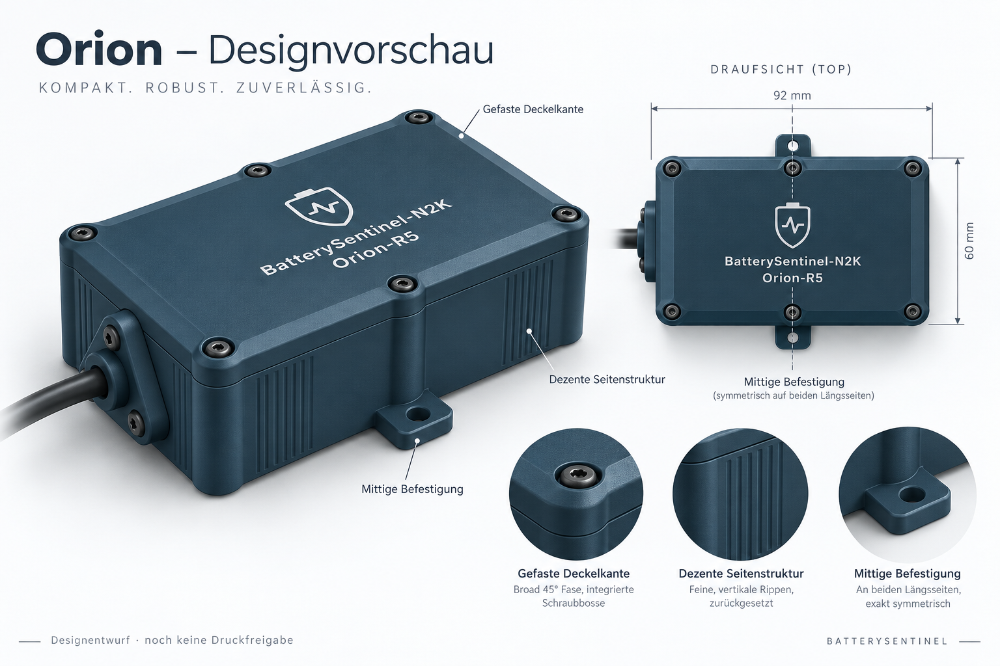

# Orion enclosure styling preview

This is an AI-generated industrial design proposal requested by the user, not a CAD render, dimensional drawing or print release. The approved concept is implemented as V2.2 in `../sealed-v2`; use its CAD previews and validation reports for the actual geometry.

## Symmetry finding

In `tools/build_orion_enclosure_v2.py`, the rectangular face extends from X=-28 to X=64, placing its centre at X=18 mm. The two middle lid screw axes and the mounting tabs are still defined at X=10 mm. No functional dependency requiring this offset was found in those definitions. Proposed correction: move both matching lid/base screw features and both mounting tabs +8 mm in X to X=18 mm. Preserve the corner axes and existing continuous seal loop. Check the new blind insert pockets, material around the sealing groove, and mounting-tool access in CAD before releasing the revision.

## Styling proposal

- Symmetric middle screws and opposing mounting tabs on the long-side midpoint.
- Broad shallow perimeter chamfer on the lid, rounded shoulders, integrated screw bosses and softened tab roots.
- Flat central branding face, with flush contrasting logo/text kept centred.
- Subtle external vertical ribs confined to side panels; no ventilation openings.
- Rounded and faceted cable cap retaining the three-screw sealing function.
- Preserve independent strain relief, service openings, PCB locations and sealing system.

Generated with the built-in image generation tool using the current assembled CAD preview as reference. Prompt brief: premium petrol-blue FDM enclosure, chamfered lid, integrated bosses, external rib texture, six symmetric lid screws and two centred mounting tabs; consistent perspective and top views. The depicted finish, dimensions and hardware are illustrative. The exact appearance and print orientation still require a CAD/slicer review; in particular, a bevel must not compromise the face-down two-colour lid's support or surface quality.

## Progress / open work

- [x] Locate the offset in the existing generator.
- [x] Create and visually review a styling proposal with corrected symmetry.
- [x] User approved the styling direction for implementation.
- [x] Implemented V2.2 CAD with centred fasteners/tabs, integrated shell, bevels and external texture.
- [x] Verified sealing lands, washer seats, mounting-tool access, solid meshes and native plate slicing.
- [x] Re-exported CAD/STL/3MF and updated both illustrated manuals.
- [ ] Physical fit, USB reach, material calibration, clamp retention and sealing acceptance remain outstanding.

## Visual correction after user review

V2.1 did not reproduce the approved proportions of the bevel and ribbed side fields. V2.2 broadens the lid bevel to 2.4 mm, adds rounded projecting middle shoulders, recessed fields with two visible rib bands, and replaces the cap spokes with a smooth faceted shoulder. Compare the actual `../sealed-v2/preview-styled-presentation.png` with the concept; the presentation uses actual CAD plus illustrative hardware.
