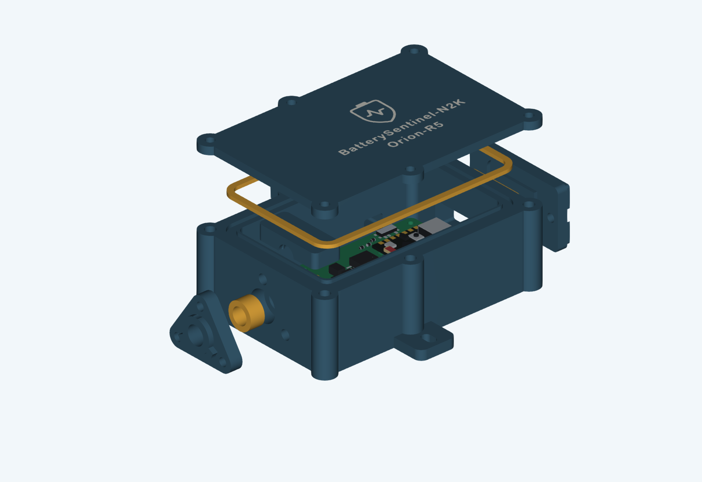

# Orion Bridge enclosure V2 - separate strain relief

This revision implements the approved 27 September 2026 concept for the user's **7 mm cable jacket** and ordered **SainSmart Flex TPU Air (77A-93A)**. It separates cable retention from sealing. The previous 95A TPU trial failed to retain the cable and bent the pressure cap; softer material alone is not treated as a complete correction.

The body is nominally **92 x 60 x 33.2 mm**, excluding ears, covers, ribs and screw heads. The cable side is 16 mm longer; the 52 x 36 mm PCB and the USB/switch positions are retained. The lid keeps its flush contrasting PETG artwork. The lower clamp saddle and blind clamp bosses are integrated into the base. The cable pressure cap has three screws, a 5 mm body and 2 mm exterior ribs. Face seals have a rounded bead, 1.8 mm free height and 1.4 mm closed height.

**Prototype, not physically qualified.** See the digital reports below. A valid CAD solid or successful slice is not evidence of waterproofness, Shore hardness, clamp retention or a tested IP rating. The old print files and user test plates remain intact in `../sealed-print`; do not mix old and V2 seals.

## Start here

The complete print package contains the CAD, 27 STLs (including alternatives/coupons), five 3MF projects, profiles, both manuals and validation reports.

1. Read the [manufacturing and TPU Air manual](../manuals/Orion-Enclosure-V2-Manufacturing-EN.pdf) and [assembly manual](../manuals/Orion-Enclosure-V2-Assembly-EN.pdf). Both are in English, following the project documentation convention.
2. Print the PETG entry/insert coupon and the TPU flow/material coupons first. Verify the purchased insert dimensions before a complete base.
3. Calibrate TPU Air at the actual nozzle/speed. Flow 1.00 in the trial profiles is an **uncalibrated seed**, not a production recommendation.
4. Select the sleeve and matched clamp shims by physical tests. Complete the empty-case exposure tests before installing electronics.

## Deliverables

| File | Purpose |
| --- | --- |
| `Orion-Enclosure-V2.FCStd` | Editable FreeCAD assembly including current PCB/component reference bodies |
| `Orion-Enclosure-V2-assembly.step` | Assembly exchange geometry, with simplified seated TPU envelopes |
| `*.stl` and `print-manifest.json` | Print-oriented parts, alternatives and calibration items |
| `Orion-V2-PETG.3mf` | Structural production parts; lid body/markings grouped as one two-colour object |
| `Orion-V2-PETG-Coupons.3mf` | Entry coupon, cap, upper clamp, shims and face-stop fixtures |
| `Orion-V2-TPU-Air-235C.3mf` | TPU geometry with the 235 C calibration start |
| `Orion-V2-TPU-Air-245C.3mf` | Same TPU geometry with the 245 C calibration start |
| `Orion-V2-TPU-Air-255C.3mf` | Same TPU geometry with the 255 C calibration start |
| `profiles/` | Separately named flattened machine/process/material inputs for this revision |
| `parameters.json` | Measured cable diameter, editable design inputs and engineering hardness targets |
| `validation.json` | CAD bodies, assembly/PCB clearances, blind pilots, sealing lands, STL topology and STEP readback |
| `package-validation.json` | Actual native slicer, plate/layout/toolpath and mesh-repair checks |
| `source-preservation.json` | Hashes confirming previous CAD and saved 3MF were not changed |

TPU projects repeat the geometry deliberately for independent temperature comparisons; they are **alternative trial jobs**, not three complete sets required for one enclosure. Select only the intended samples in the slicer. First print `flow_wall_coupon`, then the hardness pad and representative seals after flow correction. Print exactly one chosen cable sleeve for assembly. PETG and TPU stay on separate jobs.

The prepared projects contain editable geometry/settings, not cached print-ready G-code. Check the actual build plate, nozzle, material mapping and calibration and re-slice. PETG colours require same-layer material changes (for example AMS); TPU uses external feed. This is a new conservative V2 setup, not a merge of an unverified live user profile. The previous user project is retained unchanged.

## TPU Air development targets

| Seal | Engineering Shore A target | Initial nozzle / comparison |
| --- | --- | --- |
| Lid | 80-85 A | 245 C; compare 235 and 255 C |
| USB and switch | 83-88 A | 235 C; compare 245 C |
| Cable sleeve | 85-90 A | 235 C; compare 245 C |

These are proposed functional targets, **not measured results or guaranteed hardness at a given temperature**. No verified SainSmart/P2S temperature-to-hardness map is available here. Use the 50 x 50 x 6 mm comparison pad with a Shore A durometer and the instrument's prescribed method. Record the thin seals' functional results separately. Without an instrument, hardness remains unmeasured.

Shared starts: 0.4 mm nozzle, 0.20 mm layers, nominal 0.42 mm line width, 20 mm/s deposition, 15 mm/s first layer, 50 C bed, 3 walls, 5 top/bottom layers, 100% infill, moderate cooling and 2 mm3/s volumetric ceiling. Recalibrate flow at every temperature/nozzle/speed. 100% infill still permits foaming inside the extrusion and does not prove impermeability. Full instructions, record sheets and sources are in the manufacturing manual.

## Sleeve and clamp selection

- Cable jacket: 7.0 mm, confirmed by the user; check ovality/tolerance.
- Sleeve bead bores: 6.7 / 6.8 / 6.9 mm. Sleeve free lengths: 6.6 / 6.8 / 7.0 mm. All nine alternatives share a 6.0 mm closed seat; the initial choice is `cable_seal_b6p8_L6p8`.
- The raised annular end bead faces the pocket shoulder inside the case; feed the unsplit sleeve onto the bare cable end before soldering.
- Three cap screws tighten evenly to rigid lands. The sleeve does not need to pass a cable-pull test by itself.
- Clamp: two screws and a 12 mm contact length with three rounded ribs. Start with equal 0.4 mm shims, compare 0.2 mm and no shim only as needed. Larger shims reduce jacket compression. The assembly CAD shows the 0.2 mm pair as a reference.
- Do not overtighten to repair a mismatched sleeve, failed material or poor print. No screw torque, pull-force rating or leak rating has been physically qualified.

## Hardware for one enclosure

| Item | Quantity | Notes |
| --- | ---: | --- |
| M3 x 8 | 6 | Lid |
| M3 x 10 | 9 | USB/switch 4; cable cap 3; clamp 2 |
| M3 flat washer, nominal 0.5 mm thick | 15 | No countersunk heads; verify actual thickness/seat |
| M3 heat-set insert | 15 | Nominal 5.7 mm body; validate actual purchased insert on coupon |
| M2 x 5, head <= 4.0 mm | 4 | PCB; do not substitute lid screws |
| M2 heat-set insert | 4 | Nominal 4.0 mm body; validate actual purchase |
| Mounting screws + washers | 2 sets | Select for the mounting surface |

Coupon trials consume additional inserts. Nominal M3 pilots are 4.0 x 6.7 mm; M2 pilots 3.2 x 4.6 mm. Confirm actual insert, washer and screw dimensions. All exterior insert pockets and internal-clamp posts are blind. The mounting holes remain outside the seal loop.

## Rebuild and evidence

Run `tools/build_orion_enclosure_v2.py` with FreeCAD 1.1's bundled Python, then `tools/package_enclosure_v2.py` with the bundled document/runtime Python. The latter uses the installed QuackSlicer for native checks. `tools/build_enclosure_v2_manuals.py` generates the two manuals from the current CAD illustrations. Run `tools/verify_enclosure_v2_delivery.py`, render and visually review the PDFs, then run `tools/archive_enclosure_v2.py` to create the checked archive. These scripts live in the project root's tools directory; they use the existing PCB, branding and helper sources.

Seated TPU CAD bodies are conservative geometry envelopes, not volume-conserving deformation/contact-pressure simulations. The printable STLs contain the actual free bead shapes. The lid body's cutout and marking solids use the same source contours and print transform. Physical testing remains necessary for FDM bridge quality, seam roughness, foam porosity, creep, jacket compression, thermal/RF behaviour and the real USB plug.

## Progress and remaining acceptance

- [x] Confirmed 7 mm cable input and recorded failed prior 95A trial.
- [x] Implemented the enlarged bay, independent clamp, stiff pressure cap, bead seals, variants and coupons.
- [x] Reviewed final digital CAD, mesh, STEP and native-slicer reports: no assembly collisions; all five jobs slice without mesh repairs. Independently checked exported triangles, deposited seal heights and contrasting lid layers.
- [x] Reviewed all 16 rendered manual pages; archive creation verifies CRC and SHA-256 against its contents (checksums: `../SHA256SUMS.json`; full delivery report remains in the repository).
- [ ] Measure actual insert bodies and confirm coupon fit.
- [ ] Calibrate actual SainSmart spool/nozzle; measure hardness or record it as unmeasured.
- [ ] Pass independent jacket retention, 24-48 h creep/recovery and empty-case leak checks.
- [ ] Complete actual board, plug, wiring, temperature and radio acceptance.

Sources: [SainSmart TPU Air](https://www.sainsmart.com/products/lightweight-tpu-filament) and [Bareiss specimen guidance](https://www.bareiss-testing.com/digital-durometer-hardness-tester/), consulted 27 September 2026. Supplier print ranges and instrument guidance do not establish this enclosure's physical performance.
